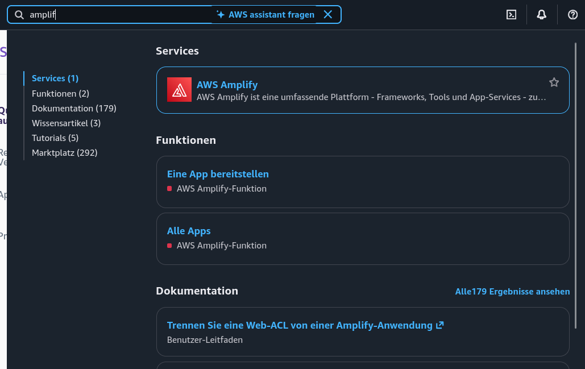
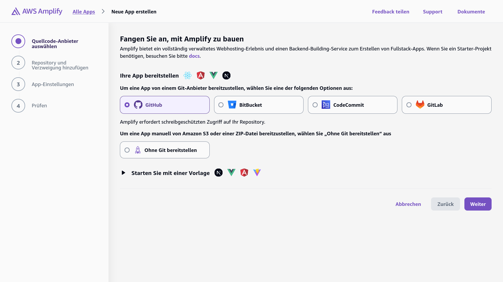
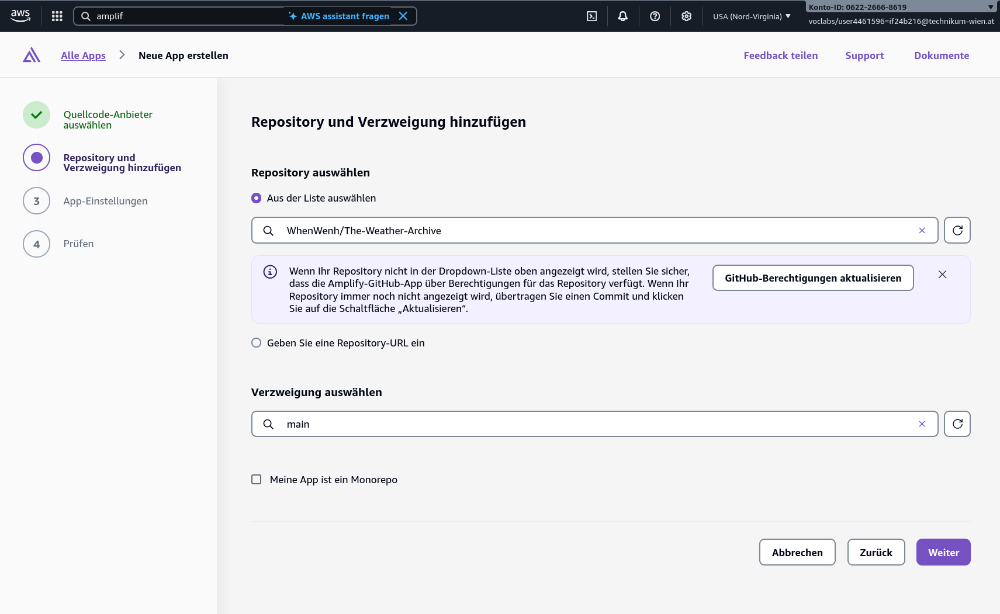
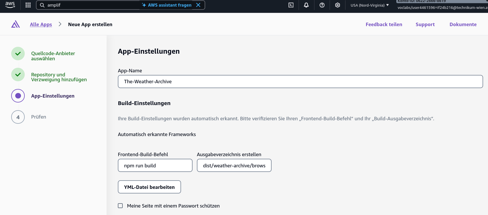
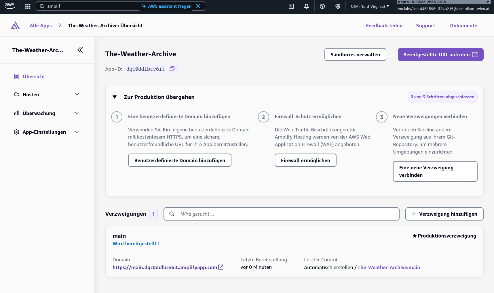
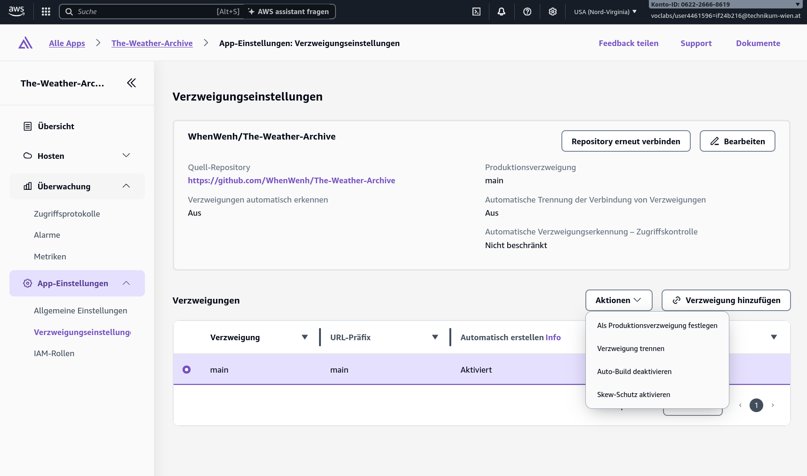

# The Weather Archive – Frontend mit AWS Amplify Hosting

## Warum Amplify Hosting?

Amplify Hosting stellt den statischen Angular-Build unter einer öffentlichen HTTPS-Adresse bereit. Dieselbe Adresse kann für die erste Live-Demo und die finale Abgabe verwendet werden. Mit aktiviertem Auto-Build baut und veröffentlicht Amplify neue Versionen nach einem Push oder Merge auf `main`.


[AWS Amplify Hosting](https://docs.aws.amazon.com/amplify/latest/userguide/welcome.html) · [AWS Amplify-Preise](https://aws.amazon.com/de/amplify/pricing/)

## 1. Frontend lokal prüfen

Im Angular-Projektordner mit Node.js 24 ausführen:

```bash
npm ci
npm start
```

Unter `http://localhost:4200` prüfen, ob das Logo, das Suchfeld und der Search-Button sichtbar sind. Den Entwicklungsserver mit `Ctrl+C` beenden und den Produktionsbuild prüfen:

```bash
npm run build
ls dist/weather-archive/browser/index.html
```

Amplify veröffentlicht den Ordner, der die gebaute `index.html` direkt enthält. Für dieses Projekt lautet der Pfad `dist/weather-archive/browser`.

## 2. GitHub mit Amplify verbinden

1. In der AWS Management Console **AWS Amplify** öffnen und **Create new app** wählen.



2. **GitHub** als Quelle auswählen. 



3. Bei der Autorisierung **Only select repositories** wählen und `The-Weather-Archive` freigeben.

4. In Amplify das Repository und den Branch **`main`** auswählen. **Monorepo-App-Stamm** bleibt leer, weil `package.json` direkt im Stamm des Repositorys liegt.



5. Unter **Build-Einstellungen** `npm run build` als Build-Befehl und `dist/weather-archive/browser` als Ausgabeverzeichnis eintragen.



6. Standard-Build-Instanz und Standard-Image beibehalten. Passwortschutz für die öffentliche Demo deaktiviert lassen.
7. **Speichern und bereitstellen** wählen. Nach dem Status **Deployed** die angezeigte `amplifyapp.com`-URL in einem privaten Browserfenster öffnen und die Startseite prüfen.



[AWS-Anleitung zum GitHub-Zugriff](https://docs.aws.amazon.com/amplify/latest/userguide/setting-up-GitHub-access.html)

### Build-Konfiguration

Die Build-Einstellungen können in der Amplify-Konsole gespeichert werden. Alternativ können wir eine `amplify.yml` neben `package.json` versionieren. Sobald sie auf `main` liegt, hat sie für diesen Branch Vorrang vor der Konfiguration in der Konsole.

```yaml
version: 1
frontend:
  phases:
    preBuild:
      commands:
        - nvm use 24
        - npm ci --cache .npm --prefer-offline
    build:
      commands:
        - npm run build
  artifacts:
    baseDirectory: dist/weather-archive/browser
    files:
      - '**/*'
  cache:
    paths:
      - '.npm/**/*'
```

Amplify installiert die Abhängigkeiten aus `package-lock.json`, führt den Angular-Build aus und veröffentlicht die Dateien aus `baseDirectory`. `package-lock.json` gehört ins Repository. `node_modules/` und `dist/` werden beim Build erzeugt und bleiben in `.gitignore`. [AWS-Build-Konfiguration](https://docs.aws.amazon.com/amplify/latest/userguide/build-settings.html) · [Node.js-Version für Amplify-Builds](https://docs.aws.amazon.com/amplify/latest/userguide/troubleshooting-general.html)

## 3. Automatisches Deployment testen

1. Prüfen, ob Auto-Build für `main` aktiv ist.
2. In `src/app/app.html` den Buttontext vorübergehend von `Search` zu `Search city` ändern.
3. Die Änderung committen und auf `main` pushen. Wenn das Team Pull Requests nutzt, den Pull Request nach `main` mergen.

   ```bash
   git add src/app/app.html
   git commit -m "Test Amplify deployment"
   git push origin main
   ```

4. In Amplify den neuen Build für `main` öffnen und auf **Deployed** warten.
5. Die bestehende Website neu laden. Erscheint `Search city`, wurde die Änderung veröffentlicht.

Ein lokaler Produktionsbuild ist für diesen Test optional. Bei einem fehlgeschlagenen Deployment zuerst das Build-Log prüfen. Meldet Amplify einen fehlenden Ausgabeordner, den lokalen Build-Pfad mit `baseDirectory` abgleichen. [Automatische Amplify-Builds](https://docs.aws.amazon.com/amplify/latest/userguide/build-settings-configuration.html)

## 4. Bilder im Angular-Frontend hinzufügen

Das Logo beispielsweise als `public/images/weather-archive-logo.png` speichern. Angular kopiert den Inhalt von `public/` beim Build in den Ausgabeordner. Daher lautet die URL im Browser `/images/weather-archive-logo.png`.

In `src/app/app.html` die bestehende Logo-Überschrift bei Bedarf so ersetzen:

```html
<h1 class="logo">
  
</h1>
```

In `src/app/app.css` ergänzen, damit sich das Logo auf schmalen Bildschirmen verkleinert:

```css
.logo img {
  display: block;
  width: min(100%, 24rem);
  height: auto;
  margin-inline: auto;
}
```

Mit `npm start` lokal prüfen. Anschließend das Bild und die geänderten Dateien gemeinsam committen. Beim nächsten Deployment wird das Bild mit veröffentlicht.

## Kosten und automatische Builds

AWS Amplify Hosting kann Kosten für Build-Minuten, gespeicherte Dateien und ausgelieferten Datenverkehr verursachen. Aktives Studentenguthaben wird automatisch angerechnet, sofern es Amplify abdeckt. Den Restbetrag und das Ablaufdatum sehen wir unter **AWS Billing → Credits**.

Mit aktiviertem **Auto-Build** startet ein Push oder Merge auf `main` einen neuen Build. Wenn bis zur Demo keine Änderungen mehr veröffentlichen, kann Auto-Build unter **App-Einstellungen → Branch-Einstellungen → `main` → Aktionen** deaktiviert und später wieder aktiviert werden.



Die zuletzt veröffentlichte Website bleibt unter derselben URL öffentlich erreichbar. Neue Git-Pushes lösen währenddessen keine automatischen Builds aus. Speicher und Datenverkehr können weiterhin Kosten verursachen. Sobald die URL für die Bewertung nicht mehr benötigt wird, kann die Amplify-App gelöscht werden.

[AWS Amplify-Preise](https://aws.amazon.com/de/amplify/pricing/) · [Auto-Build deaktivieren](https://docs.aws.amazon.com/amplify/latest/userguide/edit-build-settings.html#turning-off-automatic-builds-on-every-commit)